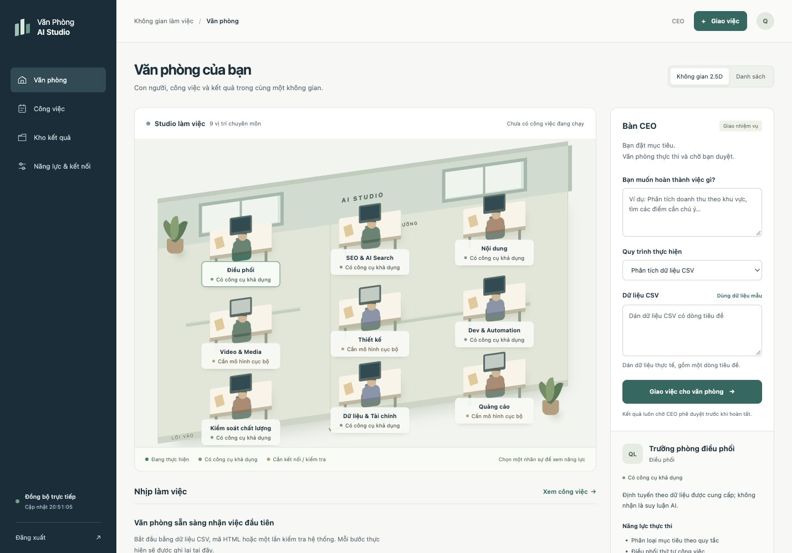

# Văn Phòng AI Studio v4

Văn phòng điều hành công việc local: giao mục tiêu → thực thi có giới hạn → lưu sản phẩm/bằng chứng → QC độc lập → CEO nghiệm thu đúng phiên bản.

Đây là bản nền tảng chạy thật với công cụ xác định. Trưởng phòng dùng **RULE_ENGINE**; phân tích CSV, kiểm tra HTML và thống kê runtime dùng **DETERMINISTIC_TOOL**. Soạn thảo bằng model chỉ hoạt động sau khi cấu hình và kiểm tra provider local. Không nhận là đã có tám chuyên viên LLM tự chủ hoặc đủ năng lực tạo video, ảnh, xuất bản quảng cáo.



## Chạy ứng dụng

Yêu cầu **Node.js >=22.13** (đã kiểm tra trên Node 22.23.4, macOS Intel). Không cần `npm install`, GPU hoặc dịch vụ trả phí. `node:sqlite` còn phát cảnh báo experimental trên Node 22; đây là tình trạng runtime, không phải lỗi khởi động.

```bash
./start.sh
# Mở http://127.0.0.1:3333
```

Nếu cổng 3333 đang có dịch vụ cũ, script sẽ không giết tiến trình đó. Dùng cổng riêng:

```bash
PORT=3434 ./start.sh
# Mở http://127.0.0.1:3434
./stop.sh
```

`stop.sh` xác minh đúng executable + đường dẫn server + instance trước khi gửi SIGTERM. Mỗi data directory chỉ có một scheduler.

Lần đầu, ứng dụng tạo `.studio/access-token` (CEO) và `.studio/read-token` (chỉ đọc), quyền600. Xem khóa trên máy của bạn rồi dán vào ô đăng nhập; khóa không được đưa vào Git, URL hoặc browser storage. Nút đăng xuất thu hồi cả SSE. Session cần đăng nhập lại sau restart.

Có thể đặt `STUDIO_DATA_DIR` vào một **thư mục dữ liệu chuyên dụng**. Runtime đặt quyền thư mục700 để bảo vệ CSV/ngữ cảnh; không trỏ biến này vào một thư mục tài liệu dùng chung. Khi đổi data directory phải dùng cùng biến cho start/stop. Không chia sẻ khóa CEO.

## Thử luồng đầu tiên

1. Đăng nhập, chọn **Phân tích dữ liệu CSV**.
2. Nhập mục tiêu: `Tính tổng doanh thu và chi phí từ dữ liệu đã cung cấp`.
3. Dán CSV sau (dữ liệu mẫu tổng hợp), hoặc bấm **Dùng dữ liệu mẫu**:

```csv
khu_vuc,doanh_thu,chi_phi
Bac,120,50
Trung,80,30
Nam,100,40
```

4. Giao việc. Trưởng phòng phân công tính thống kê → đóng gói báo cáo → QC. Xem task, timeline, công cụ, lượt chạy và sự kiện thật.
5. Mở `analysis.json`, `report.md`, **Xem đầu vào** và các tiêu chí QC. Kết quả mẫu có tổng doanh thu300, chi phí120. Không có điểm chất lượng tự gán.
6. **Yêu cầu chỉnh sửa** kèm nhận xét, sau đó **Thử thực thi lại** để có phiên bản mới. Phiên bản cũ được giữ. Công cụ xác định chạy lại cùng dữ liệu; muốn đổi dữ liệu/brief, giao task mới.
7. **Phê duyệt kết quả** chỉ áp dụng cho phiên bản đang xem và kiểm tra lại checksum trước khi DONE.

Bảng **Công việc**, **Kho kết quả**, **Năng lực & kết nối** và chế độ danh sách dùng cùng dữ liệu thật với văn phòng 2.5D. QC nội dung/thẩm mỹ chưa có căn cứ tự động được ghi **Cần người kiểm tra**. CEO chịu trách nhiệm xem sản phẩm trước khi duyệt.

## Năng lực hiện có

| Quy trình | Kết quả thực | Giới hạn |
| --- | --- | --- |
| Phân tích CSV | JSON thống kê từng cột + báo cáo từ dữ liệu đã dán; QC tính lại bằng parser riêng | Thống kê mô tả, không phải tư vấn tài chính; số học floating-point |
| Kiểm tra HTML ngoại tuyến | Title, description, H1, số liên kết và nguồn hash | Không truy cập URL/crawl/Lighthouse/CWV; HTML lỗi có thể đếm chưa chính xác |
| Kiểm tra runtime | Node, OS, kiến trúc, PID, thời điểm quan sát | Không khẳng định máy an toàn hoặc mọi công cụ hoạt động |
| Bản nháp bằng model local | Văn bản + model/provider/usage nếu endpoint cung cấp | Phải cấu hình và probe; chưa kiểm chứng model thực trong phiên này |
| Video, thiết kế, quảng cáo | Có thể giao soạn brief/kịch bản qua adapter văn bản khi có model | Chưa render/sinh ảnh/mua hoặc xuất bản quảng cáo |

## Provider local tùy chọn

Không tải model, cài Ollama hoặc gọi sinh nội dung tự động. Chỉ cấu hình một endpoint tương thích Chat Completions mà bạn biết chắc chạy model local:

```bash
STUDIO_AI_BASE_URL=http://127.0.0.1:11434/v1 \
STUDIO_AI_MODEL='<tên-model-local-đã-cài>' \
PORT=3434 ./start.sh
```

Sau khởi động, vào **Năng lực & kết nối → Kiểm tra kết nối cục bộ**. `/models` phải thực sự công bố đúng model; probe hết hạn sau 60 giây. Mỗi draft ghi đúng model và chỉ nhận completion `stop`. Endpoint chỉ nhận literal loopback, không redirect, không key cloud hoặc URL từ request. Các tên model cloud rõ ràng bị từ chối. Một proxy trên localhost vẫn có thể gọi dịch vụ ngoài; runtime không chứng minh nội bộ của server đó. Chỉ cấu hình server local đã kiểm soát, không proxy dịch vụ tính phí.

ChatGPT Plus Web Bridge cũ được giữ làm tài liệu/mã lịch sử, **đã tắt trong runtime v4**. Không xem ChatGPT Plus là API. Skills/MCP của phiên Codex không tự động trở thành quyền của ứng dụng.

## Dữ liệu và khôi phục

`.studio/` chứa SQLite WAL, khóa local, PID/lock, log và artifact UUID theo task/lượt chạy. Agent definitions/công cụ nằm trong registry có version trong mã; trạng thái workflow, attempts, events, QC, nguồn, artifact và approvals được lưu trong SQLite. Task đang chạy khi crash chuyển INTERRUPTED và chờ retry; task còn QUEUED có thể tiếp tục. Không tự gửi lại yêu cầu model đã bị ngắt.

Giới hạn: 2 tác vụ chạy, 50 queued/running, 500 task, 20 lượt/task, 100 MiB output được giữ chỗ trước ghi. Việc giữ chỗ cho lượt lỗi/crash được bảo toàn để không bỏ sót artifact dở dang. Khi đầy, giữ backup và chuyển data directory mới; không tự xóa dữ liệu. JSON request 600 KiB, nguồn 500 KiB, CSV tối đa 10.000 dòng/200 cột. Snapshot bỏ dữ liệu nguồn hàng loạt; xem nguồn qua endpoint có xác thực riêng.

Dữ liệu nghiệp vụ ở thư mục cha được giữ nguyên và chỉ tham khảo qua allowlist. Các seed/DONE/QC/approval cũ không nhập thành nghiệm thu mới. Mã cũ vẫn xem được ở commit `aee38ba`. **Không chạy** `test_bridge_e2e.js`, `test_verification_suite.js` hoặc công cụ executor cũ với dữ liệu gốc: chúng là kiểm thử lịch sử và có thể sửa file ngoài repo.

Backup an toàn: `./stop.sh`, sao chép **toàn bộ thư mục dữ liệu** sang nơi riêng có quyền truy cập hạn chế, rồi start. Không chỉ copy file SQLite khi WAL đang hoạt động. Có thể kiểm tra backup bằng một data directory riêng; đừng chạy hai server dùng cùng DB.

## Kiểm thử và hồ sơ bàn giao

```bash
npm test
```

Các test mới trong `tests/` dùng fixture/tmp riêng; HTTP chỉ bind loopback. Trong sandbox cần quyền mở cổng local. Provider fixtures là **test double**, không chứng minh model thật. Browser MCP đã kiểm tra luồng CSV và XSS, desktop và390px; ảnh nằm trong `docs/screenshots/`.

- [Báo cáo kỹ thuật và giới hạn](docs/ENGINEERING_REPORT.md)
- [Kết quả nghiệm thu và bằng chứng](docs/ACCEPTANCE.md)
- [Kiểm toán baseline](docs/LEGACY_AUDIT_2026-11-08.md)
- [API](docs/API.md), [thiết kế](docs/superpowers/specs/2026-11-08-next-generation-office-design.md), [kế hoạch](docs/superpowers/plans/2026-11-08-next-generation-office.md)

Nhánh: `codex/next-generation-office`; chưa merge/push. Rollback: dừng bản v4, giữ backup `.studio/`, mở checkout riêng từ `aee38ba` để đối chiếu mã cũ. Không bật lại server cũ trên mạng vì các lỗi đã ghi trong kiểm toán; không dùng `reset --hard`, xóa lịch sử hoặc ghi đè dữ liệu để rollback.
