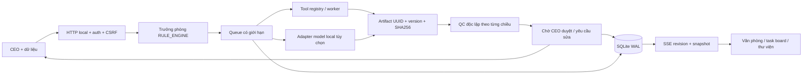

# Engineering report — Văn Phòng AI Studio v4

Ngày08/11/2026, múi giờ Việt Nam. Baseline `aee38ba`; nhánh làm việc `codex/next-generation-office`.

## Executive summary

Thay entrypoint monolith bằng runtime local có xác thực và persistence, đồng thời thay dashboard bằng văn phòng 2.5D/danh sách kết nối trạng thái thật. Đã thực hiện luồng end-to-end từ dữ liệu CSV → thống kê/báo cáo → QC tính lại → yêu cầu sửa → artifact v2 → duyệt CEO. Kết quả là nền tảng điều phối công cụ có bằng chứng, chưa phải toàn bộ công ty AI tự chủ trong tầm nhìn dài hạn.

Trước đây báo cáo/connector/QC có thông tin viết sẵn và một số đường thực thi bỏ qua lỗi QC. Bản mới không nhận tệp tồn tại là đủ nghiệm thu, không tự gán điểm95/100, không đưa lỗi về DONE, không tự biến skill thành quyền thực thi, không báo provider sẵn sàng khi chưa probe.

## Kiến trúc và quyết định

| Phần | File | Trách nhiệm |
| --- | --- | --- |
| Transport | `server.js`, `src/http.js` | Loopback, auth/session, reader/admin, CSRF, SSE, route allowlist |
| Lưu trữ | `src/store.js` | SQLite WAL/FULL, transaction, scheduler ownership, private files, idempotency, reservation output |
| Điều phối | `src/engine.js` | Phân công theo capability, dependencies, queue với 2 worker, timeout/cancel/retry, state, version và approvals |
| Công cụ | `src/tools.js`, `src/tool-worker.js` | CSV thực, HTML ngoại tuyến, runtime inventory, draft provider |
| Cách ly CPU | `src/work.js`, `src/work-worker.js` | HTML và QC trong worker có abort/deadline; CSV có worker riêng |
| Kiểm soát | `src/qc.js` | Parser CSV riêng, tính lại số liệu, đối chiếu nguồn/report, kiểm tra các chiều, không cấp điểm |
| Model | `src/providers.js` | Loopback Chat Completions adapter, probe và model/finish/response bounds |
| UI | `public/index.html`, `public/app.js`, `public/style.css` | Office2.5D/list, composer, task board, timeline, sources, QC, approvals, artifact và năng lực |
| Vòng đời | `tools/lifecycle.js`, `start.sh`, `stop.sh` | Chỉ quản lý tiến trình đúng entrypoint/instance; không kill tiến trình theo cổng |

Giữ Node/vanilla để không cần cài package, không tải framework hoặc GPU. Built-in SQLite đã thử trên Node 22.23.4; đòi hỏi>=22.13 và còn có experimental warning trên Node 22. WAL/FULL và transaction bảo vệ metadata; file artifact ghi riêng, `wx`, fsync, chỉ trình CEO sau khi đọc lại/checksum/QC. Đây không phải một transaction phân tán giữa SQLite và filesystem: crash có thể để lại tệp chưa đăng ký; giữ nguyên, không tự xóa, reservation vẫn tính ngân sách.

Quyền sở hữu scheduler kiểm tra trong transaction SQLite; PIDfile chỉ để quan sát/vòng đời, không phải khóa duy nhất. PID reuse có thể giữ khóa bảo thủ nếu PID cũ đã được hệ điều hành tái dùng; không tự giết tiến trình để xử lý. Queued tasks tiếp tục sau restart; RUNNING thành INTERRUPTED. Không tự retry provider không rõ đã xử lý hay chưa. Retry là thao tác rõ ràng, giữ idtask và tạo attempt/version mới; khóa idempotency bền vững chặn retry/dispatch lặp.

Mỗi task có chuỗi chuyên viên → đóng gói báo cáo → QC với dependencies cố định theo loại công cụ. Đây là phối hợp vai trò bằng công cụ xác định; không tự nhận ba LLM đã trao đổi. Trưởng phòng phân loại theo đầu vào/từ khóa có nhãn RULE_ENGINE, không tự lập DAG tùy ý qua model. Task đơn giản không tạo đội agent rỗng.

## Bảo mật đã xử lý trong runtime mới

- Bind127.0.0.1; kiểm tra Host chính xác để chặn DNS rebinding, Origin/Fetch Metadata cho API; không wildcard CORS/Private Network allow.
- Admin và reader token ngẫu nhiên, tệp600; thư mục700, ownership và DB/WAL/SHM/lock không symlink/hardlink. Session HttpOnly/SameSite Strict, CSRF header trên thay đổi, giới hạn phiên và đăng nhập. Logout thu hồi SSE.
- Không shell/exec từ brief, path hoặc URL. Không có endpoint đọc đường dẫn tùy ý, không auto-fetch URL. Legacy execution/bridge trả410 sau xác thực.
- Download qua artifactID đã đăng ký, kiểm tra realpath/file type/size/hash; từ chối symlink ở root/ancestor khi ghi. Approval đọc lại artifact hiện hành, gắn version; không thể duyệt lỗi hoặc phiên bản cũ.
- CSP, nosniff, frame denial; frontend dựng untrusted text bằng textContent, preview plaintext. Payload img/onerror thực tế không tạo img hoặc chạy script.
- Body/source/output, queue/tasks/attempts, response/SSE backpressure có giới hạn. CPU worker ngăn HTML regex/input nặng khóa mainloop.
- Provider chỉ URL cấu hình loopback literal, không redirect, không URL từ task; chưa hỗ trợ API cloud/key cloud. Probe đúng `/models`, hết hạn60giây; response phải xác nhận đúng model và finish_reason stop. Tênmodel hosted/cloud rõ ràng bị từ chối. Không độc lập chứng minh serverlocal không proxy cloud: quản trị viên phải cấu hình server mình kiểm soát.

Đây là ranh giới bảo vệ local giữa browser/role/app files; không phải sandbox chống malware hoặc chương trình khác chạy cùng tài khoản macOS. Không kiểm toán an ninh hệ điều hành hay penetration test toàn diện.

## QC và bằng chứng

QC tách `technical`, `format`, `source`, `data`, `content`, `aesthetic`, `approval`. CSV tính lại bằng scanner khác producer; report phải khớp kết quả và nêu giới hạn. HTML chỉ đối chiếu kiểm tra pattern của nội dung đã cung cấp; không nhận là auditSEO tổng thể. Runtimeinventory kiểm tra schema/provenance nội bộ, không nhận là security audit.

AI draft có hashbrief/context/output, provider/model/usage nếu có. Nội dung số liệu, phù hợp brief và thẩm mỹ vẫn UNVERIFIED. PASS ở đây có nghĩa đã đạt các kiểm tra có triển khai và có thể trình CEO; không thay thế quyết định nội dung. Tất cả quy trình bắt buộc CEO approval. QC verdict đầy đủ giữ trong từng attempt để xem lại qua nguồn trạng thái; UI hiện QC hiện hành và lịch sử attempt/artifact. Chưa có màn so sánh ngữ nghĩa hai phiên bản.

Dữ liệu cũ trong thư mục cha không được runtime mới ghi. Task Board/bộ nhớ chỉ đọc qua allowlist, có nhãn chưa xác minh. Không import seed approved thành approval thật. Knowledge files, input context và DB trạng thái được tách riêng; không tự nhét bộ nhớ dùng chung vào prompt.

## Skills, MCP và nghiên cứu thực tế

Đã đọc và áp dụng: using-superpowers, brainstorming (dựa brief đã giao quyền tự quyết), writing-plans, executing-plans, test-driven-development, dispatching-parallel-agents, requesting-code-review, verification-before-completion và impeccable. Các approvalround/thiết kế lặp không áp dụng vì user trực tiếp ủy quyền chọn giải pháp và yêu cầu tiến hành code. Ba phần độc lập được giao kiểm toán baseline, frontend, tools/QC/providers; review cuối có context mới.

Impeccable launcher không chạy vì permissiondenied; sử dụng fallback đọc PRODUCT/DESIGN và các reference trực tiếp. Không cài/chạy detector ngoài. Browser MCP điều khiển Chrome thật để đăng nhập, giaoCSV, xemsource/report, sửa/retry v2/approve, kiểm traXSS, viewportdesktop/mobile và lưuảnh. Node builtins, git, shell, ffmpeg/SQLiteCLI có trong máy; ffmpeg không dùng để dựng sản phẩm trong bản mới. Không chạy skill/công cụ chỉ vì hiện diện. MCP/skill của phiên làm việc không bị tự chuyển quyền sang app.

Tham khảo nguồn chính thức: [OWASP CSRF Prevention](https://cheatsheetseries.owasp.org/cheatsheets/Cross-Site_Request_Forgery_Prevention_Cheat_Sheet.html) cho kiểm tra Origin/CSRF phòng thủ nhiều lớp, [Ollama OpenAI compatibility](https://docs.ollama.com/api/openai-compatibility) cho giao diện local `/v1/models`/chat. Không càiOllama hoặc gọi model thật. Khả năng SQLite được kiểm tra bằng runtime cục bộ, không dựa riêng vào mô tả thư viện.

## Giới hạn và quyết định cần trước merge

- Chưa có provider/model thật được cấu hình: test model chỉ local doubles có nhãn. Không chứng minh chất lượng suy luận AI, chi phí, độ trễmodel hay toàn bộ tám chuyên môn.
- Chưa có render video/ảnh, full SEO crawl, file Office export, thẩm mỹ media model, skill execution sandbox, arbitraryworkflowgraph, cloudprovider hoặc external MCPadapter trong ứng dụng. Roles không có tool tương ứng ghi rõ giới hạn.
- Chưa có multiuser identity/SSO; CEO là quyền admin của workspace, không phải danh tính doanh nghiệp ký số. Không public deploy.
- Danh mục agent/tool definitions lưu cùng versionmã nguồn; chưa có UI tạo agent/tools hoặc sửa workflowDAG.
- Snapshot gồm mọi metadata task trong giới hạn500, chưa có pagination/searchserver. Nguồn được đọc riêng; chưa có benchmark ở quy mô500task/100 MiB hoặc RAM/performanceSLA.
- App mới test ở cổng 3434; tiến trình cũ đang LISTENcổng 3333 không bị dừng. Muốn thay thế nó cần dừng đúng bản cũ đang dùng sau khi xem việc đang chạy; tránh start/stopscript cũ dùng kill -9 theo cổng.
- Nhánh giữ local, chưa push hoặc merge. Trước merge cần chủ dự án duyệt phạm vi, thay đổi yêu cầu phiên bản Node, bridge tắt, migrationlegacy chỉ đọc và giới hạnnăng lực. Việc bậtprovider/mạng ngoài/tính phí là quyết định riêng.

Rollback an toàn: dừng v4 bằng script đúng data directory, backup toàn bộ data directory khi đã dừng; checkout mãbaseline trong thư mục khác để đối chiếu. Giữ branch/history và `.studio`; không dùng reset-hard/clean/xóa artifact. Gitrollback không đảo ngược dữ liệu ngoài repo. Bảnbaseline có lỗi đã ghi trong kiểm toán, nên không đưa servercũ trở lại mạng như một giải pháp rollback an toàn.
